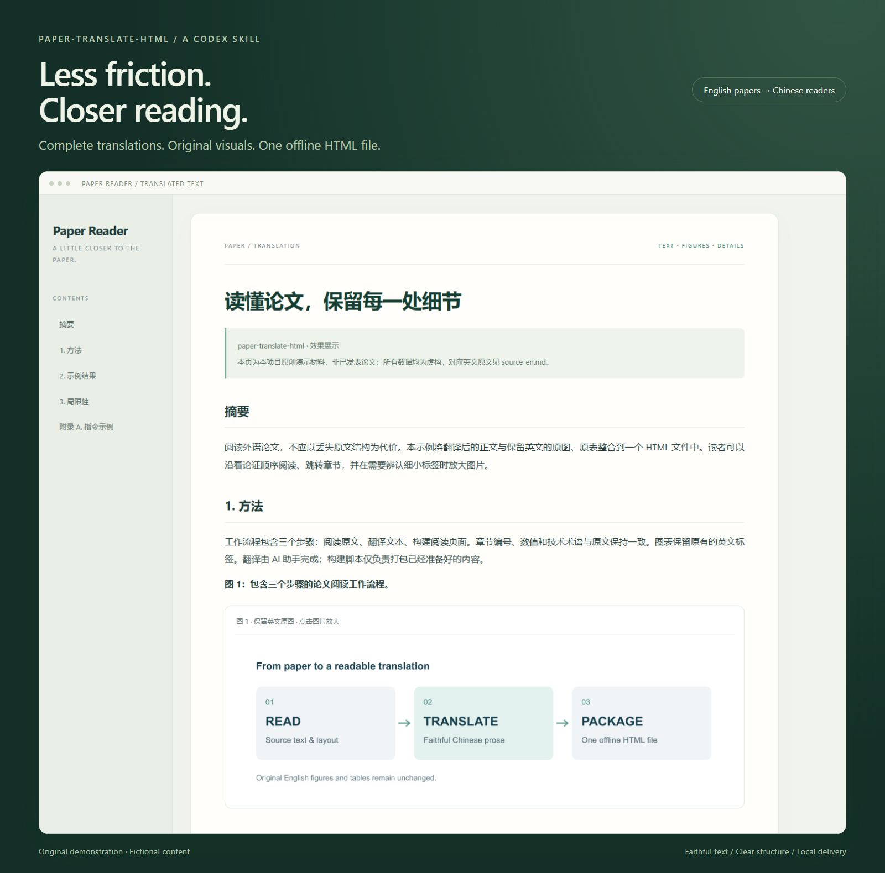

# paper-translate-html

**快速翻译，高效排版。保留原图，交付可直接阅读的中文 PDF。**

A lightweight, efficient Codex skill for full-paper Chinese translations, searchable PDFs, and original figures.

把英文论文交给 Codex，完成全文翻译、原图表提取和排版检查，默认只交付一份可搜索、可复制的中文 PDF。需要离线网页阅读时，也可以生成带目录和图片缩放的独立 HTML。

## 为什么快速、高效

- **原图直接复用。** 优先提取高清原图；复合图和表格按完整区域截图，减少重绘和数据重录。
- **翻译一次，排版复用。** 译稿与排版分开，调整字体、图表大小和分页无需重新翻译，也不逐页生成图片。
- **脚本完成重复工作。** 本地脚本负责图片嵌入、尺寸传递和 PDF 导出，让时间集中在翻译与必要核验上。
- **交付简单。** 默认只给最终 PDF，不附带制作说明、译者备注或多余文件包。

这里的“快速、高效”指减少重复处理；实际耗时取决于论文长度、扫描质量、图表复杂度和所用模型，没有固定的分钟数或速度倍数承诺。

## 保留论文该有的样子

**完整内容。** 默认覆盖所提供文件的正文和附录，保留章节、公式、数值、编号及参考文献，不用摘要替代全文。

**高清原图表。** 保留英文图表内部文字与原色，正文和图注翻译为中文，放大查看时仍有原始细节。

**小图不强行放大。** 正文采用便于中文阅读的单栏排版；图表沿用原 PDF 的实际显示宽度。原稿小图保持小尺寸，大图最多占满正文，显示大小与像素分辨率分开控制。

**字体与配色尽量跟随原稿。** 核对衬线风格、标题、粗体、斜体、修订颜色和链接颜色，再应用论文专属样式。中文使用风格接近的可用字体；不强求逐页复刻，也不声称替代字体完全一致。

**可保存、可打印。** PDF 包含可搜索的正文、页码和章节书签，导出后检查完整性、嵌入字体、分页及密集图表。

翻译由使用该 Skill 的 AI 助手完成。脚本负责提取、排版和导出，本仓库不是独立翻译模型，无需另外配置翻译 API。

## 安装

将仓库克隆到 Codex 的 skills 目录。若配置了 `CODEX_HOME`，使用其 `skills` 子目录；已有同名 Skill 时先备份或克隆到其他目录。

Windows PowerShell：

```powershell
git clone https://github.com/gfnnnb/paper-translate-html.git "$HOME/.codex/skills/paper-translate-html"
cd "$HOME/.codex/skills/paper-translate-html"
npm install
python -m pip install -r requirements.txt
npx playwright install chromium
```

macOS / Linux：

```bash
git clone https://github.com/gfnnnb/paper-translate-html.git ~/.codex/skills/paper-translate-html
cd ~/.codex/skills/paper-translate-html
npm install
python -m pip install -r requirements.txt
npx playwright install chromium
```

需要 Node.js 20+、Python 3.10+。可使用 Python 虚拟环境，或复用助手环境已有的依赖。已有兼容 Chromium／Edge 时可通过 `--browser-path` 指定，无需重复下载浏览器。安装后开启新的 Codex 会话。

## 使用

上传论文 PDF，然后告诉助手：

```text
使用 $paper-translate-html 完整翻译这篇论文，交付中文 PDF。
保留高清英文原图表，图片按原稿尺寸排版，字体和颜色尽量与原文一致。
```

也可明确要求 HTML 阅读版、指定章节或可编辑 Markdown；用户指定的范围和格式优先。

基本制作流程：

```bash
# 先由助手核对原文、提取图表并完成译稿
node scripts/build_html.cjs --input tmp/paper-zh.md --output tmp/paper-zh.html --style-css tmp/source-style.css
node scripts/export_pdf.cjs --input tmp/paper-zh.html --output output/paper-zh.pdf
npm test
```

`source-style.css` 由助手根据原稿编写，可省略以使用黑色衬线回退样式。图表提取脚本自动生成 `.layout.json` 保存原稿显示尺寸，构建和导出时沿用。完整参数及检查方法见 [工作流](references/workflow.md)。

## HTML 阅读效果示例

以下是早期 HTML 阅读器的效果示例，展示章节导航、原图表和图片放大功能。它们不是新版 PDF 的字体与排版预览；实际输出样式以所提供论文为准。示例文字和图表为仓库原创演示材料，数据均为虚构。



[英文示例](examples/source-en.md) · [中文译稿](examples/demo-zh.md) · [HTML 演示](examples/demo-zh.html)

下载 HTML 文件后用浏览器打开；GitHub 文件页面显示的是源码。运行 `npm run demo` 可使用当前模板重新生成演示。重新生成预览截图可运行 `node scripts/capture_preview.cjs`。

## 边界

- 扫描版 PDF 需要额外 OCR 和复核，本仓库不内置 OCR。
- 复杂 LaTeX 公式需要另行配置并核验数学渲染，不能直接交付未渲染代码。
- 放大不能恢复低清原图缺失的细节。字体匹配受本机字体可用性限制。
- 完整性、译文准确性及局部强调的保留需要助手检查，脚本本身不提供自动保证。
- 原始 Markdown 内的 HTML 显示为文本，远程或缺失图片会使构建失败。

## 许可

代码、文档及原创示例采用 [MIT License](LICENSE)。用户提供的论文、图表及其他第三方材料不包含在该许可中；再分发译文时须遵守相应授权。

